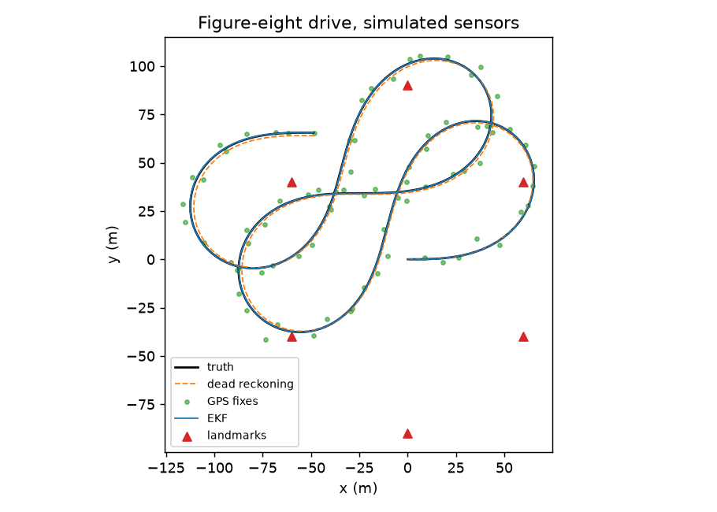

# trackfuse

Sensor fusion for a ground vehicle: an Extended Kalman Filter in C++ that combines a noisy IMU (acceleration and yaw rate), 1 Hz GPS and range-bearing observations of known landmarks into one position, heading and speed estimate. A simulator generates the drive, a NumPy reference implements the same filter, and the tests make the C++ prove itself against it.



## What is in here

| Part | What it does |
|---|---|
| `core/ekf.cpp`, `mat.hpp` | The filter. State is (x, y, heading, speed) with a unicycle motion model. Fixed-size matrices on the stack, no heap allocation in the loop, covariance update in Joseph form and re-symmetrized so it stays positive definite. Optional chi-square gate rejects outlier measurements. |
| `core/capi.cpp` | A plain C interface (`tf_run`) that takes a batch of events and returns the state and covariance after each one. |
| `core/test_core.cpp` | Unit tests run under UBSan: matrix algebra, straight-line prediction, covariance shrinking on update, landmark heading correction, outlier gating, angle wrap. |
| `trackfuse/sim.py` | Generates a figure-eight drive with 50 Hz IMU, 1 Hz GPS (3 m noise) and 5 Hz landmark observations, with optional GPS outages and bad GPS fixes. |
| `trackfuse/pyekf.py` | The same filter in NumPy, written for clarity. |
| `trackfuse/native.py` | ctypes binding to the C++ library. |
| `tests/test_filter.py` | Equivalence, accuracy, consistency, outage and outlier tests (below). |

## Run it

```bash
make -C core test                 # C++ unit tests, with sanitizers
make -C core build/libtrackfuse.so
pip install -e ".[dev]"
pytest -q
python -m trackfuse demo --plot docs/trajectory.png
python -m trackfuse bench
# or: docker build -t trackfuse . && docker run --rm trackfuse
```

## Numbers

One simulated 80 second drive (seed 1), position RMSE against the true path:

| Estimator | Position RMSE |
|---|---|
| Raw GPS fixes | 4.04 m |
| Dead reckoning (IMU only) | 1.27 m |
| EKF: IMU + GPS + landmarks | 0.13 m |

Dead reckoning drifts: on a 300 second drive it reaches 5.4 m, past the raw GPS error. With GPS cut for 20 seconds in a 60 second drive, the filter keeps 0.12 m error through the outage thanks to the landmarks, and 0.84 m if the landmarks are removed too.

Speed, on 300 seconds of the same scenario (16,861 events):

| Implementation | Time | Events per second |
|---|---|---|
| NumPy reference | 174 ms | 97 thousand |
| C++ through ctypes | 0.7 ms | 24 million |

About 250x. This is a loop of tiny 4x4 matrix operations, where NumPy's per-call overhead dominates, so the gap says more about Python overhead than about C++ being a magic wand. The C++ number is the useful one: far above any real sensor rate.

## How the C++ is trusted

- **Two implementations, one test.** The NumPy reference and the C++ must agree on state and covariance to 1e-9 on several random drives, including runs with gated outliers.
- **Statistical consistency (NEES).** Over 40 simulated runs, the average normalized estimation error squared is 3.8 (the expected value for a 4-state filter is 4). A filter that is overconfident scores far above 4, and a too-cautious one far below. This catches wrong Jacobians and wrong noise handling that a plain accuracy test would miss.
- **Failure cases are tests.** GPS outages and wildly wrong GPS fixes each have a test that checks the error stays bounded or the outlier is rejected.
- **Sanitizers.** The C++ unit tests build with address and undefined-behavior sanitizers in CI.

## Design choices worth a look

- **Process noise comes from the IMU noise** rather than a hand-tuned Q, which is what makes the consistency test meaningful.
- **Bearing residuals are wrapped** to (-pi, pi], so a landmark seen near the 180 degree seam does not produce a 360 degree error.
- **Joseph-form update** keeps the covariance symmetric and positive definite over long runs.

## Not done yet

- Real sensor logs instead of simulated ones.
- Unknown landmark positions (SLAM) and a lateral/longitudinal vehicle model.
- An Unscented Kalman Filter for comparison.
