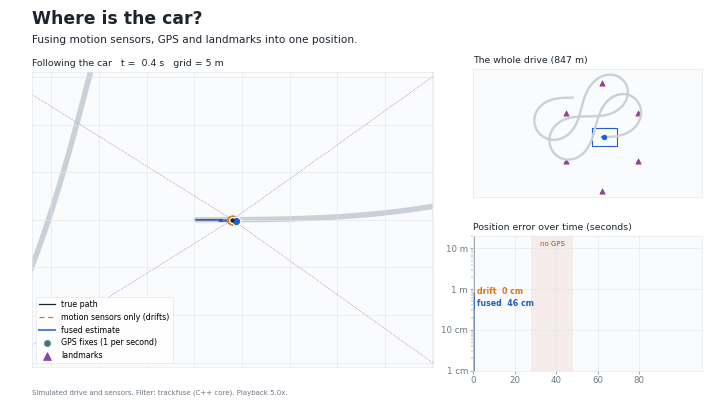
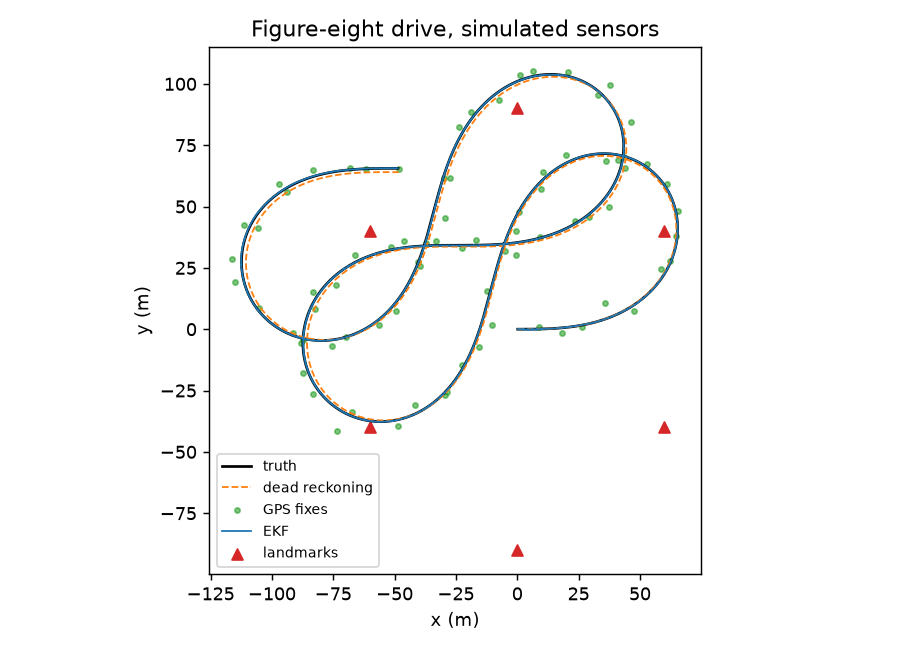
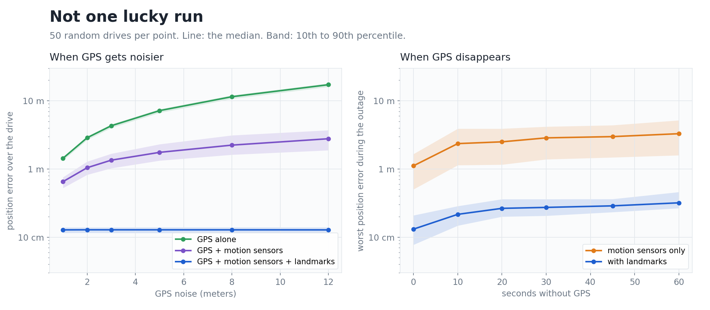
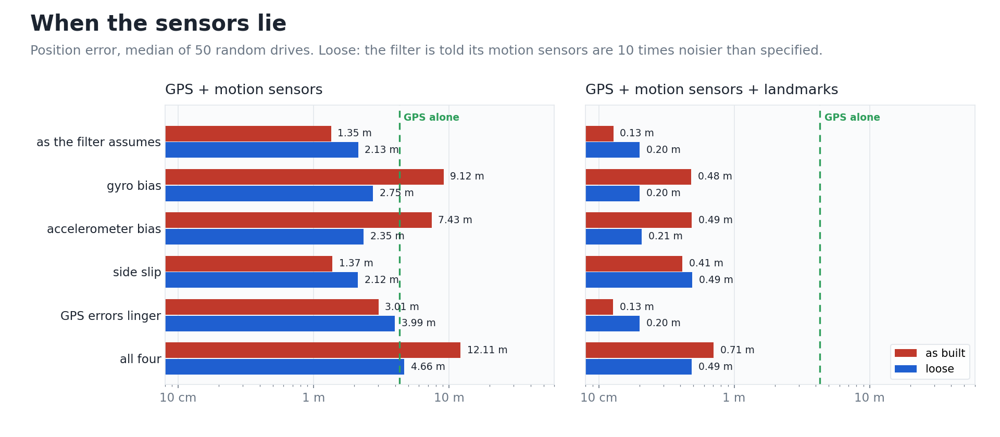

# trackfuse

Sensor fusion for a ground vehicle: an Extended Kalman Filter in C++ that combines a noisy IMU (acceleration and yaw rate), 1 Hz GPS and range-bearing observations of known landmarks into one position, heading and speed estimate. A simulator generates the drive, a NumPy reference implements the same filter, and the tests make the C++ prove itself against it.



The clip is the filter's real output on one simulated 80 second drive, not an illustration, and every number in it is computed from that run. It shows three things:

1. **Normal driving.** GPS fixes land about 4.0 m from the car. Motion sensors alone drift (1.4 m over the drive). Fused, the estimate is 0.13 m off.
2. **GPS lost for 20 seconds.** The landmarks hold the estimate at 0.13 m.
3. **One GPS fix 208 m from the truth.** The filter refuses it (a chi-square gate on how unlikely the measurement is).

An honest note on the third: with landmarks in view the filter is already sure where it is, so even with the gate off that fix would move the estimate by only 0.11 m. With GPS as the only correction it would move it by 16.6 m. The gate earns its place when GPS is all you have, which is how `test_gating_rejects_gps_outliers` tests it.

## What is in here

| Part | What it does |
|---|---|
| `core/ekf.cpp`, `mat.hpp` | The filter. State is (x, y, heading, speed) with a unicycle motion model. Fixed-size matrices on the stack, no heap allocation in the loop, covariance update in Joseph form and re-symmetrized so it stays positive definite. Optional chi-square gate rejects outlier measurements. |
| `core/capi.cpp` | A plain C interface (`tf_run`) that takes a batch of events and returns the state and covariance after each one. |
| `core/test_core.cpp` | Unit tests run under UBSan: matrix algebra, straight-line prediction, covariance shrinking on update, landmark heading correction, outlier gating, angle wrap. |
| `trackfuse/sim.py` | Generates a figure-eight drive with 50 Hz IMU, 1 Hz GPS (3 m noise) and 5 Hz landmark observations, with optional GPS outages and bad GPS fixes. |
| `trackfuse/pyekf.py` | The same filter in NumPy, written for clarity. |
| `trackfuse/native.py` | ctypes binding to the C++ library. |
| `trackfuse/animate.py` | Renders a drive as a clip (GIF or MP4) or one still frame. It replays the simulator through the filter and draws what came out. |
| `tests/test_filter.py` | Equivalence, accuracy, consistency, outage and outlier tests (below). |
| `tests/test_animate.py` | The clip's own claims: no GPS during the outage, the bad fix refused, the captions quoting the run. |
| `trackfuse/sweep.py`, `tests/test_sweep.py` | Many random drives per condition: error against GPS noise and against the length of a GPS outage. |
| `trackfuse/stress.py`, `tests/test_stress.py` | Sensor errors the filter does not model (biases, side slip, GPS errors that linger), and what each one costs. |

## Run it

```bash
make -C core test                 # C++ unit tests, with sanitizers
make -C core build/libtrackfuse.so
pip install -e ".[dev]"
pytest -q
python -m trackfuse demo --plot docs/trajectory.png
python -m trackfuse animate docs/drive.gif --width 720 --fps 12 --seconds 16   # the clip above
python -m trackfuse animate drive.mp4            # full size, needs ffmpeg
python -m trackfuse sweep --plot docs/robustness.png   # 50 random drives per point (about 15 seconds)
python -m trackfuse stress --plot docs/stress.png      # sensor errors the filter does not model
python -m trackfuse bench
# or: docker build -t trackfuse . && docker run --rm trackfuse
```

## Numbers

One simulated 80 second drive (seed 1), position RMSE against the true path:

| Estimator | Position RMSE |
|---|---|
| Raw GPS fixes | 4.04 m |
| Dead reckoning (IMU only) | 1.27 m |
| EKF: IMU + GPS + landmarks | 0.13 m |



Dead reckoning drifts: on a 300 second drive it reaches 5.4 m, past the raw GPS error. With GPS cut for 20 seconds in a 60 second drive, the filter keeps 0.12 m error through the outage thanks to the landmarks, and 0.84 m if the landmarks are removed too.

Speed, on 300 seconds of the same scenario (16,861 events):

| Implementation | Time | Events per second |
|---|---|---|
| NumPy reference | 174 ms | 97 thousand |
| C++ through ctypes | 0.7 ms | 24 million |

About 250x. This is a loop of tiny 4x4 matrix operations, where NumPy's per-call overhead dominates, so the gap says more about Python overhead than about C++ being a magic wand. The C++ number is the useful one: far above any real sensor rate.

## Not one lucky run

One good drive proves little: the seed may be lucky. `python -m trackfuse sweep` repeats the drive 50 times per point with fresh random noise, and reports the median and the spread.



What it says, in medians:

| GPS noise | GPS alone | GPS + motion sensors | + landmarks |
|---|---|---|---|
| 3 m | 4.30 m | 1.35 m | 0.13 m |
| 12 m | 17.20 m | 2.77 m | 0.13 m |

| Time without GPS | Worst error, motion sensors only | Worst error, with landmarks |
|---|---|---|
| 20 s | 2.50 m | 0.26 m |
| 60 s | 3.29 m | 0.32 m |

- **The centimeter-level result belongs to the landmarks.** With them in view the estimate stays at 0.13 m whatever the GPS does.
- **GPS and motion sensors alone still earn their keep.** Fusing cuts the error to about a third of raw GPS at 3 m of noise and to about a sixth at 12 m. A real car rarely has surveyed landmarks, so this is the honest baseline for the road.
- **The outage column is the worst moment, not the last one.** On a figure-eight a heading error pushes the estimate away and then partly back as the road curves, so the error at the end of an outage rises and falls with the geometry.

## When the sensors lie

The standard simulator errs exactly the way the filter assumes: white noise on every sensor. That is the fair test of the math, and a kind one. Real sensors also lie in ways the filter knows nothing about. `python -m trackfuse stress` switches four such effects on and measures each over 50 random drives: a gyro that reads 0.5 degrees per second too high, an accelerometer that reads 0.1 m/s^2 too high, about a degree of side slip in turns, and GPS errors that fade over 30 seconds, so a few fixes do not average them out.



Median position error over the drive ("loose" is the filter told that its motion sensors are ten times noisier than specified):

| Effect | GPS alone | GPS + motion sensors, as built | loose | + landmarks, as built | loose |
|---|---|---|---|---|---|
| None (as the filter assumes) | 4.30 m | 1.35 m | 2.13 m | 0.13 m | 0.20 m |
| Gyro bias | 4.30 m | 9.12 m | 2.75 m | 0.48 m | 0.20 m |
| Accelerometer bias | 4.30 m | 7.43 m | 2.35 m | 0.49 m | 0.21 m |
| Side slip | 4.24 m | 1.37 m | 2.12 m | 0.41 m | 0.49 m |
| GPS errors linger | 3.98 m | 3.01 m | 3.99 m | 0.13 m | 0.20 m |
| All four | 4.16 m | 12.11 m | 4.66 m | 0.71 m | 0.49 m |

- **A bias breaks the filter as built.** With no landmarks, a small constant gyro bias takes it from 1.35 m to 9.12 m, worse than GPS alone (4.30 m). The filter was told its motion sensors have only white noise, so it trusts them too much and holds on to a wrong heading. Its own uncertainty gives it away: the consistency score (NEES, about 4 when honest) reads 341.
- **Loosening is the cheap remedy.** Told that its motion sensors are ten times noisier than specified, the filter leans on its measurements: 2.75 m with the gyro bias, at the price of 2.13 m in place of 1.35 m when nothing is wrong.
- **It is not the real fix.** With all four effects, loosening only gets back to about GPS level (4.66 m against 4.16 m). The proper remedy is to estimate the two biases as part of the state and to model GPS errors that linger. That is the next step, and it is what a real driving log will demand.
- **Landmarks hide the problem.** With landmarks in view even the worst case stays under a meter, which is why the headline number alone would be flattering.

## How the C++ is trusted

- **Two implementations, one test.** The NumPy reference and the C++ must agree on state and covariance to 1e-9 on several random drives, including runs with gated outliers.
- **Statistical consistency (NEES).** Over 40 simulated runs, the average normalized estimation error squared is 3.8 (the expected value for a 4-state filter is 4). A filter that is overconfident scores far above 4, and a too-cautious one far below. This catches wrong Jacobians and wrong noise handling that a plain accuracy test would miss.
- **Failure cases are tests.** GPS outages and wildly wrong GPS fixes each have a test that checks the error stays bounded or the outlier is rejected.
- **Sanitizers.** The C++ unit tests build with address and undefined-behavior sanitizers in CI.

## Design choices worth a look

- **Process noise comes from the IMU noise** rather than a hand-tuned Q, which is what makes the consistency test meaningful.
- **Bearing residuals are wrapped** to (-pi, pi], so a landmark seen near the 180 degree seam does not produce a 360 degree error.
- **Joseph-form update** keeps the covariance symmetric and positive definite over long runs.

## Not done yet

- Gyro and accelerometer bias as part of the state, and a model for GPS errors that linger. `stress` measures this as the main weakness today.
- Real sensor logs instead of simulated ones.
- Unknown landmark positions (SLAM) and a lateral/longitudinal vehicle model.
- An Unscented Kalman Filter for comparison.
